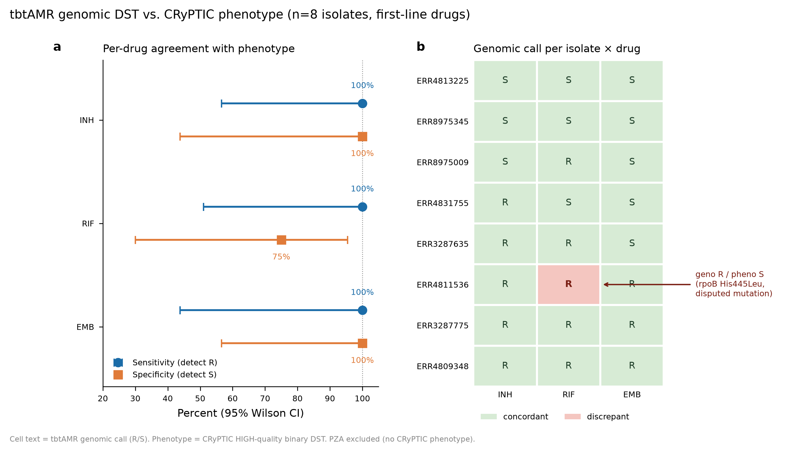
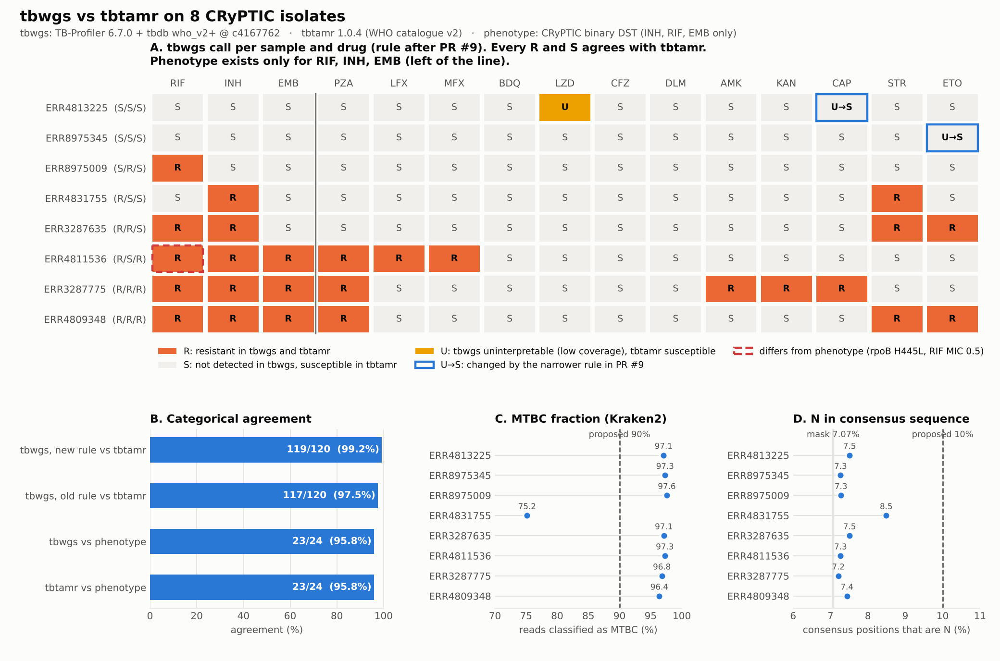
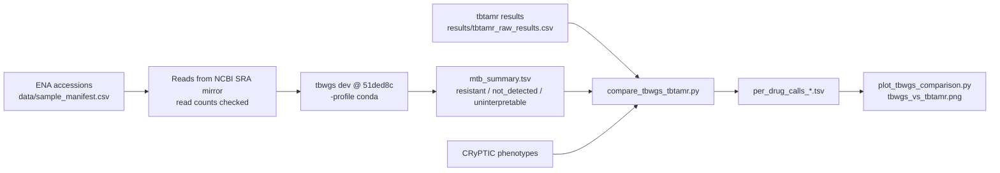

# tbtAMR genomic DST — validation exercise

Reproduction and validation of the MDU-PHL **tbtAMR** genomic drug-susceptibility
(genomic DST) workflow for *Mycobacterium tuberculosis*, against the WHO mutation
catalogue v2, on public whole-genome-sequencing data with known CRyPTIC
phenotypes.

Method reproduced: Horan et al., *Lancet Digital Health* 2025;7(12):100939
(the NATA / ISO 15189-accredited MDU-PHL TB genomics service).
Tool: https://github.com/MDU-PHL/tbtamr

> **Scope:** this is a **method-validation exercise on public data — not a clinical
> release**, not patient-reportable, and not a substitute for locally accredited
> verification. See the limitations section of the validation summary.

## Headline result

| Drug | Sensitivity (95% CI) | Specificity (95% CI) | Concordance |
|------|----------------------|----------------------|-------------|
| Isoniazid  | 100% (57–100) | 100% (44–100) | 8/8 |
| Rifampicin | 100% (51–100) | 75% (30–95)   | 7/8 |
| Ethambutol | 100% (44–100) | 100% (57–100) | 8/8 |
| **Overall** | **100% (76–100)** | **92% (65–99)** | **23/24** |

- **100% sensitivity** for resistance detection (0 very major errors).
- **95.8% overall categorical agreement** (23/24 calls).
- The single discordance (RIF, ERR4811536) is a disputed `rpoB p.His445Leu`
  mutation — a false-susceptible *phenotype* near the MIC breakpoint, not a
  tool error.
- 95% CIs are Wilson intervals and are wide by design at n=8: this demonstrates
  analytical validity, **not** clinical fitness.



## Cross-check: tbwgs vs tbtamr

The same 8 isolates were run through [biowei/tbwgs](https://github.com/biowei/tbwgs), a
Nextflow MTB WGS pipeline (TB-Profiler 6.7.0 with the frozen tbdb who_v2+ @ `c4167762`).
Its per-sample, per-drug calls were compared with the tbtamr results above and with the
CRyPTIC phenotypes.



| Comparison | Agreement |
|---|---|
| tbwgs vs tbtamr, 8 isolates × 15 drugs (rule from tbwgs PR #9) | **119/120 (99.2%)** |
| tbwgs vs tbtamr, first run (rule before PR #9) | 117/120 (97.5%) |
| tbwgs vs phenotype (INH, RIF, EMB) | 23/24 (95.8%) |
| tbtamr vs phenotype (INH, RIF, EMB) | 23/24 (95.8%) |

- Every resistant call agrees, and so does the mutation behind it. Examples are
  `rpoB S450L`, `katG S315T`, `inhA c.-154G>A`, `embB M306V`, `rrs n.1401A>G` and `gyrA D94G`.
- No disagreement is R against S. Each disagreement is a drug that tbwgs calls
  `uninterpretable` because a gene has a median depth below 10×, and tbtamr calls susceptible.
  - **ERR4813225, linezolid:** the median depth of `rrl` is 7×, against 36× for the whole genome.
    This is a real coverage gap, so the call stays `uninterpretable`.
  - **ERR4813225, capreomycin** and **ERR8975345, ethionamide:** these are caused by low-coverage
    genes that carry no resistance-graded mutation for the drug. One is `rrl` for capreomycin.
    The other is a real `Rv3083` deletion. tbwgs PR #9 checks only genes that carry an
    "Assoc w R" or "Assoc w R - Interim" mutation, so both calls are now `not_detected`.
- The one disagreement with phenotype is the same for both tools. It is ERR4811536 RIF,
  `rpoB p.His445Leu`, which is borderline at MIC 0.5 mg/L (see Deliverable 2).
- tbtamr outputs no lineage. tbwgs reports these lineages: L1.2.2.2, L2.2.1 (×2), L4.1.2, L4.1.2.1,
  L4.3.3, L4.4.1.1 and L4.8. No mixed lineage was found. No two isolates are within 12 SNPs
  (the minimum distance is 205).
- The run also set two QC thresholds in tbwgs:
  - `mtb_min_mtbc_fraction = 90` (flag only). Clean isolates were 96.4–97.6% MTBC.
    ERR4831755 was 75.2%, with 17% unclassified reads and 2% *M. abscessus*, but its calls were
    still correct.
  - `mtb_max_consensus_n = 10`. The fixed mask alone makes 7.07% of the consensus N.
    The isolates were 7.2–8.5% N.

### How the comparison was done



1. Fetch the reads for the 8 accessions. ENA could not be reached from the compute
   environment, so the reads came from the NCBI SRA open-data mirror (`fasterq-dump`).
   The read counts match the manifest.
2. Run tbwgs with default thresholds and the Kraken2 `k2_standard_08gb_20240904` database.
   All commands are in `tbwgs_comparison/code/run_tbwgs.sh`.
3. Map the calls to one scale. For tbwgs, `resistant` → R, `not_detected` → S and
   `uninterpretable` → U. For tbtamr, "Resistant" and "Low-level resistant" → R, and
   "Susceptible" and "Susceptible (not reportable)" → S.
4. Compare the 15 drugs that both tools report, for each sample, against tbtamr. Compare
   INH, RIF and EMB against phenotype.
5. Recompute the summary with the PR #9 rule (`mtb_summary.py` 1.1.0) from the same
   TB-Profiler results, and compare again.

To regenerate the tables and the figure:

```bash
for v in 1.0.0 1.1.0; do
  python tbwgs_comparison/code/compare_tbwgs_tbtamr.py \
    tbwgs_comparison/tbwgs_outputs/mtb_summary_v$v.tsv \
    results/tbtamr_raw_results.csv data/sample_manifest.csv \
    tbwgs_comparison/results/per_drug_calls_v$v.tsv
done
python tbwgs_comparison/code/plot_tbwgs_comparison.py   # needs matplotlib
```

## Repository layout

```
deliverables/   The three headline outputs
  deliverable1 … run record (single isolate, full command trace + QC)
  deliverable2 … validation report + figure (per-drug sens/spec + discrepancy)
  deliverable3 … two-page ISO 15189:2022 §7.3-aligned summary (PDF + md)
data/           sample_manifest.csv — 8 isolates: ENA accessions, MD5s,
                CRyPTIC binary phenotypes + MICs (NO FASTQs; fetch from ENA)
results/        Analysis products (tidy matrix, per-drug metrics, raw tbtAMR
                output, QC stats)
code/           analyze_validation.py, run_tbtamr.sh, env manifest, install log
logs/           Per-sample stderr command logs
run_outputs/    Per-isolate tbtAMR results + variant tables (BAMs excluded)
tbwgs_comparison/
  tbwgs_vs_tbtamr.png  Comparison figure
  tbwgs_outputs/       tbwgs summary (before/after PR #9), TB-Profiler JSON,
                       Kraken2 reports, QC, SNP distances, software versions
  results/             per_drug_calls_v1.0.0.tsv / v1.1.0.tsv (one row per sample × drug)
  code/                run_tbwgs.sh, compare_tbwgs_tbtamr.py, plot_tbwgs_comparison.py
```

## Reproduce

1. **Environment** (macOS Apple Silicon shown; on x86-64 Linux drop `--platform`):
   ```bash
   micromamba create -y -p ./tbenv --platform osx-64 \
       -c conda-forge -c bioconda tbtamr "openjdk>=11"
   ```
   The accredited method runs on x86-64 Linux; this exercise used emulated
   osx-64 under Rosetta 2 (bioconda ships no osx-arm64 builds for the pinned
   delly/samtools versions). Tool versions are identical to the recipe. Full
   detail in `code/install_log.md`.

2. **Fetch reads** from ENA — accessions and MD5s are in
   `data/sample_manifest.csv`; verify MD5 after download.

3. **Run** per isolate:
   ```bash
   code/run_tbtamr.sh tbtamr full --seq_id <id> -1 <R1.fastq.gz> -2 <R2.fastq.gz> --threads 8
   ```

4. **Analyse:**
   ```bash
   python code/analyze_validation.py
   ```
   (needs `results/tbtamr_raw_results.csv` + `data/sample_manifest.csv`)
   → regenerates `genomic_dst_tidy.csv` and `per_drug_performance.csv`.

## Key versions

tbtamr 1.0.4 · mutamr 0.0.2 · bwa 0.7.18 · samtools/bcftools 1.20 ·
freebayes 1.3.8 · delly 1.2.8 · snpEff 5.2 · OpenJDK 25 · Python 3.14.
Catalogue: WHO v2 (`who_v2_catalog.csv`, 48,151 rows). Reference: H37Rv NC_000962.3.

## Data provenance

- **Reads:** ENA (EBI), Illumina paired-end, MD5-verified against ENA records.
- **Phenotypes:** CRyPTIC compendium `CRyPTIC_reuse_table_20221019.csv`
  (EBI public release), HIGH-quality binary DST only.
- **Note:** CRyPTIC isolates contributed to WHO v2 catalogue development, so the
  genomic calls are not fully independent of the reference catalogue. Pyrazinamide
  was not validated (no PZA phenotype in CRyPTIC). See the summary's limitations.

## Credits

- **tbtAMR** and the accredited workflow: MDU-PHL (Microbiological Diagnostic
  Unit Public Health Laboratory). Please cite Horan et al., *Lancet Digital Health*
  2025;7(12):100939 and the tbtAMR repository.
- **Phenotype/genome data:** the CRyPTIC Consortium.
- This repository is an independent reproduction/validation exercise by a third
  party; it is not affiliated with or endorsed by MDU-PHL or CRyPTIC.

## License

Code and documentation in this repository: MIT (see `LICENSE`). Underlying
sequence/phenotype data are the property of their respective sources (ENA,
CRyPTIC) under their own terms.
